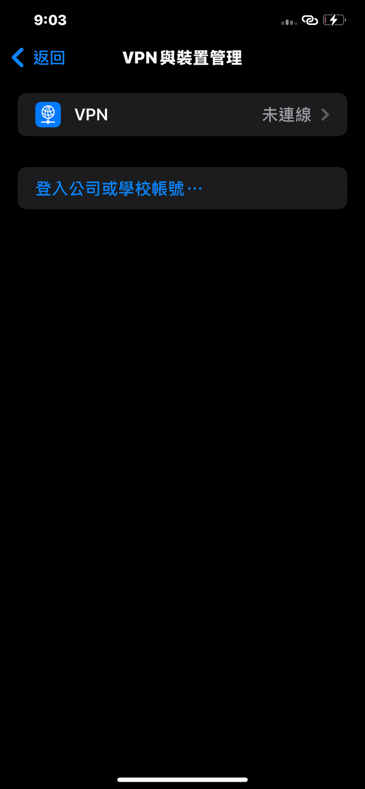
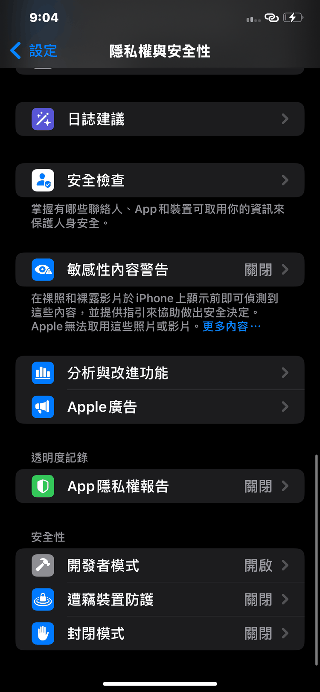

# 第 2 章：安裝 PinFly 與開發者模式

**先看這裡**：安裝有兩種方法。方法 A 用電腦上的 iloader（一種把 App 裝到 iPhone 的工具）。方法 B 用 iPhone 上已有的 SideStore（另一種側載工具）。第一次安裝建議用方法 A。

## 2.1 取得安裝檔

1. 到 PinFly 的 GitHub 發布頁下載最新的 `.ipa` 安裝檔。 〔待確認：正式發布頁網址與檔名〕
2. 把檔案存到電腦的「下載」資料夾。
3. 不要改檔名，也不要解壓縮。

## 2.2 方法 A：用電腦上的 iloader 安裝

iloader 是一個免費的電腦工具，可以把 IPA 裝到 iPhone 上。 〔待確認：下載網址與最新版本〕

1. 用 USB 傳輸線把 iPhone 接到電腦。
2. 在 iPhone 上按「信任」，並輸入 iPhone 密碼。 〔待確認：畫面文字〕
3. 打開 iloader。
4. 確認 iloader 的「目前裝置」顯示你的 iPhone 名稱。 〔待確認：畫面位置〕
5. 按 `Import IPA`（匯入安裝檔）。 〔待確認：按鈕文字〕
6. 選擇剛才下載的 `.ipa` 檔。
7. 輸入你的 Apple ID 與密碼。
8. 如果 Apple 傳來 6 位數驗證碼，輸入到 iloader 的畫面。
9. 等待畫面顯示安裝完成，再到 iPhone 主畫面找 PinFly 圖示。

*截圖說明：iloader 主畫面，標出「目前裝置」與安裝 IPA 的按鈕位置。 〔待確認：畫面為實際截圖後替換〕*

*截圖說明：iloader 選擇 IPA 檔案的視窗，檔名列表中選中 PinFly 的 `.ipa` 檔。*

## 2.3 方法 B：用 SideStore 安裝

SideStore 是一個裝在 iPhone 上的側載工具。如果你已經在用它，可以直接安裝。

1. 打開 SideStore。
2. 按右上角或下方的「＋」。 〔待確認：按鈕位置〕
3. 選擇 PinFly 的 `.ipa` 檔（先用「檔案」App 把 IPA 存在 iPhone 裡）。
4. 等待安裝完成。

*截圖說明：SideStore 的「＋」按鈕與安裝 IPA 的選擇畫面。 〔待確認：畫面為實際截圖後替換〕*

## 2.4 信任開發者（以免費 Apple ID 安裝時）

用免費 Apple ID 側載的 App，第一次打開前要先信任安裝時使用的 Apple ID。

1. 開啟「設定」›「一般」，點「VPN 與裝置管理」。
2. 有「開發者 App」區塊時，點選安裝時使用的 Apple ID（此區塊不一定會出現，沒有時略過 2、3 步）。
3. 按「信任」，在提示中再確認一次。

Apple 對同一路徑的說明（企業 App 版本）寫明：路徑為「設定」>「一般」>「VPN 與裝置管理」；iOS 18 以後按鈕可能是「允許並重新啟動」，較早版本是「信任」（https://support.apple.com/zh-tw/118254）。 〔待確認：免費 Apple ID 側載的 App 在 iOS 18／26 是否同樣顯示「允許並重新啟動」〕

*截圖說明：「VPN 與裝置管理」頁面，開發者 App 區列出安裝時使用的 Apple ID。*

*截圖說明：點進 Apple ID 後的「信任」按鈕與確認提示。*

## 2.5 開啟開發者模式

PinFly 是開發者簽名的 App。Apple 說明開發者模式用於確認使用者了解安裝開發者簽名軟體的風險；「開發者模式」要在 iPhone 與電腦配對過後才會出現在設定中（https://developer.apple.com/documentation/xcode/enabling-developer-mode-on-a-device）。所以請先完成 2.2 的連接與安裝。

1. 開啟「設定」›「隱私權與安全性」。
2. 捲到最下方，在「安全性」區點選「開發者模式」。
3. 打開「開發者模式」開關。
4. 在跳出的警示中確認重新啟動。 〔待確認：繁中按鈕文字，Apple 英文文件為「Restart」〕
5. 重新開機後解鎖，在警示中確認開啟（Apple 英文文件為「Enable」） 〔待確認：繁中按鈕文字〕，再輸入 iPhone 密碼。

*截圖說明：「隱私權與安全性」頁面最下方「安全性」區的「開發者模式」列。*

*截圖說明：開發者模式開關已開啟，畫面跳出重新啟動警示。*

*截圖說明：重新開機後出現的開啟開發者模式確認警示。*

## 2.6 第一次打開

1. 在 iPhone 上點 PinFly 圖示打開。
2. 首頁會出現地圖與「還沒配對」的提示。這是正常的，第 3 章處理。
3. 第一次定位時，iPhone 會詢問是否允許 PinFly 使用位置，請允許。第 6 章會再說明。

*截圖說明：PinFly 首頁第一次打開時的畫面，上方出現「還沒配對」提示卡。*

> 小提醒：免費 Apple ID 安裝的 App 只能用 7 天。第 5 章會教你續簽。
