# 第 7 章：捷徑自動化

**先看這裡**：iPhone 內建的「捷徑」App 可以把 PinFly 的動作排成自動化。最常用的是每天早上鬧鐘響、停止後，自動檢查並續簽。Apple 不允許 App 自己建立自動化，你需要照本章步驟建一次。

## 7.1 名詞

| 詞 | 白話說明 |
|---|---|
| 捷徑（Shortcuts） | iPhone 內建的 App，可以把多個動作接成一串 |
| 動作（Action） | 捷徑中的一個步驟，例如「續簽 PinFly」 |
| 自動化（Automation） | 讓捷徑在指定時間或事件發生時自動執行 |
| 參數 | 動作裡可以調整的選項，例如「剩幾天內才續簽」 |
| 結果 | 動作執行後回報的成功或失敗，可以用「如果」判斷 |

## 7.2 PinFly 提供的動作

以下動作名稱與參數取自 App 的程式定義，請在「捷徑」App 搜尋 `PinFly` 找到。 〔待確認：公開版動作名稱是否相同〕

| 動作名稱 | 做什麼 | 主要參數（預設值） |
|---|---|---|
| 剩幾天內才續簽 PinFly | 剩餘天數小於等於設定值時才續簽，還夠用就不做 | 只在剩幾天內才續簽（3）；失敗時停止捷徑（關）；最多等幾秒（20，範圍 10～25） |
| 續簽 PinFly | 不管剩幾天，馬上續簽 | 失敗時停止捷徑（關）；最多等幾秒（20） |
| 下載 PinFly 描述檔 | 向 Apple 下載新簽名，先存在 PinFly，還不裝上（4G 可用） | 快到期才下載（開）；剩幾天算快到期（3）；失敗時停止捷徑（關）；最多等幾秒（20） |
| 安裝 PinFly 描述檔 | 把已下載的新簽名裝上（需要 LocalDevVPN） | 失敗時停止捷徑（關）；最多等幾秒（20） |
| 查簽名剩幾天 | 不連網路，只讀目前簽名還能用幾天 | 無 |
| 目前模擬狀態 | 回報現在有沒有在模擬、在哪個地點，不改定位 | 無 |

「失敗時停止捷徑」預設是關閉的。這代表即使失敗，捷徑還會繼續往下跑。若要判斷失敗，請加上「如果」動作（見 7.4）。

## 7.3 建議做法 A：每天固定時間自動續簽

每一步只做一件事，截圖中的黃框是要點的位置。App 內「設定 › 使用教學 › 捷徑自動化」是同一份步驟。

### 何時執行

1. 打開「捷徑」App，點下方「自動化」。
2. 點「新增自動化操作」（已有自動化時點右上角「＋」）。

   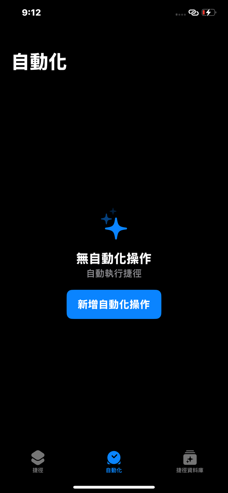

3. 點「特定時間」。

   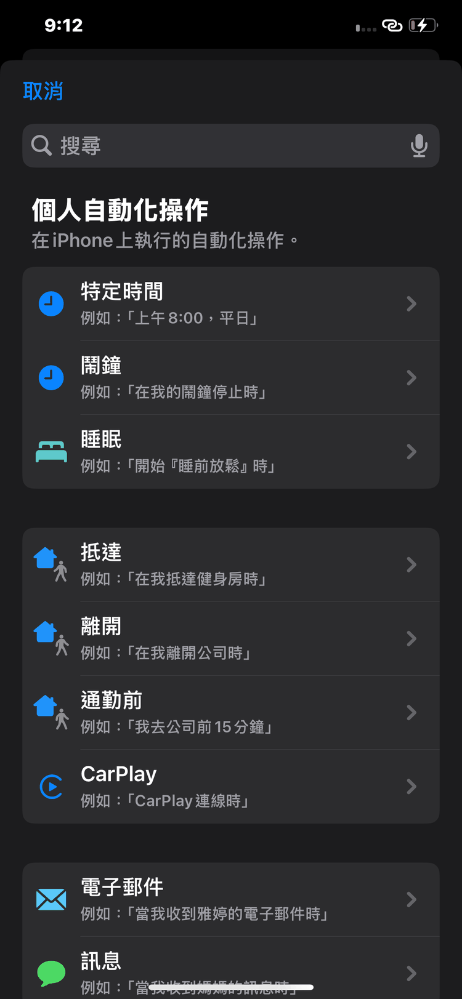

4. 將時間設為每天要續簽的時間，例如 8:00。
5. 在「重複」選「每天」。

   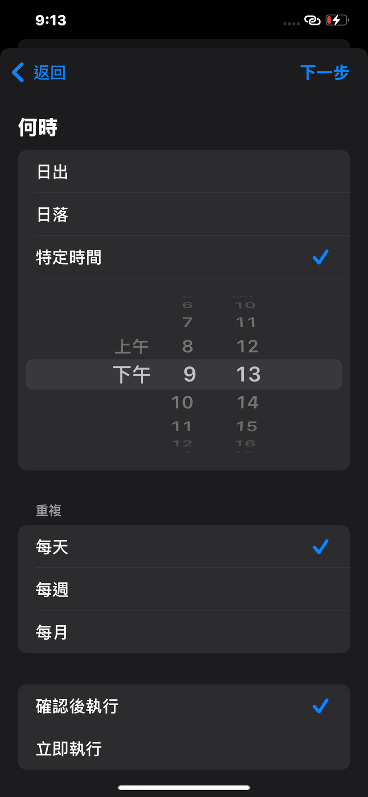

6. 點「立即執行」。選「確認後執行」時，每次都要手動點通知才會執行；選「立即執行」才能在無人操作時自動續簽。
7. 點右上角「下一步」。

   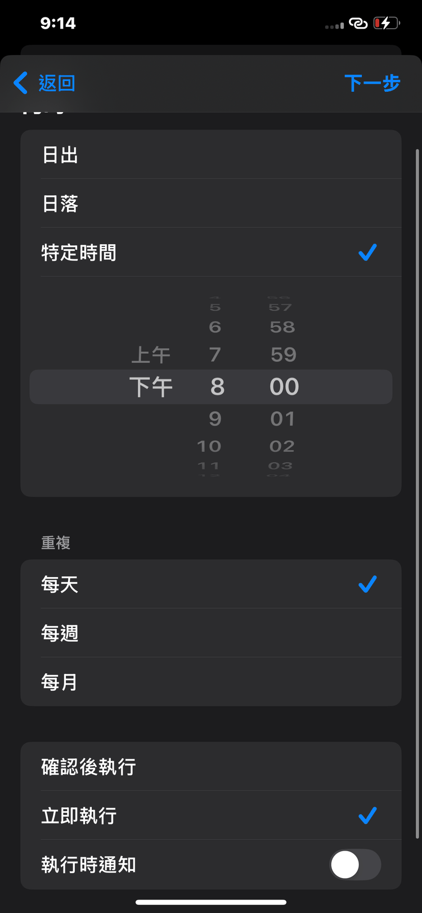

### 執行動作

8. 點「新增空白的自動化操作」。

   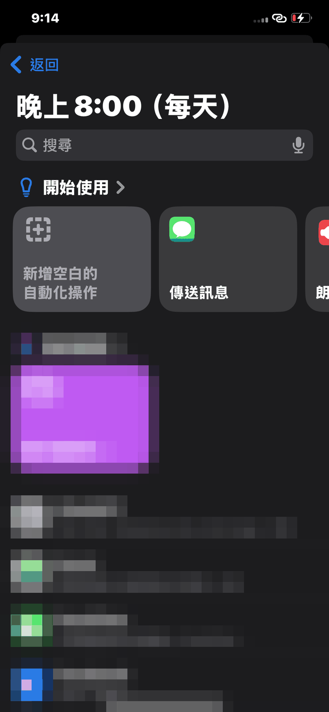

9. 點下方「搜尋動作」，輸入「LocalDevVPN」。

   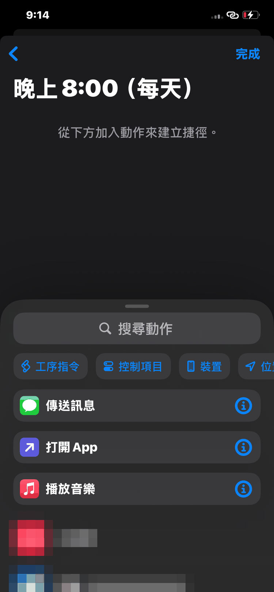

10. 點選「Enable LocalDevVPN」加入。

    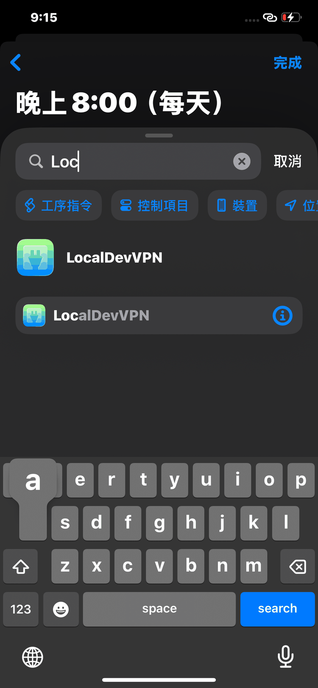

11. 再搜尋「等待」，加入後設為 3 秒。「等待 3 秒」讓 LocalDevVPN 完成連線後再續簽。

    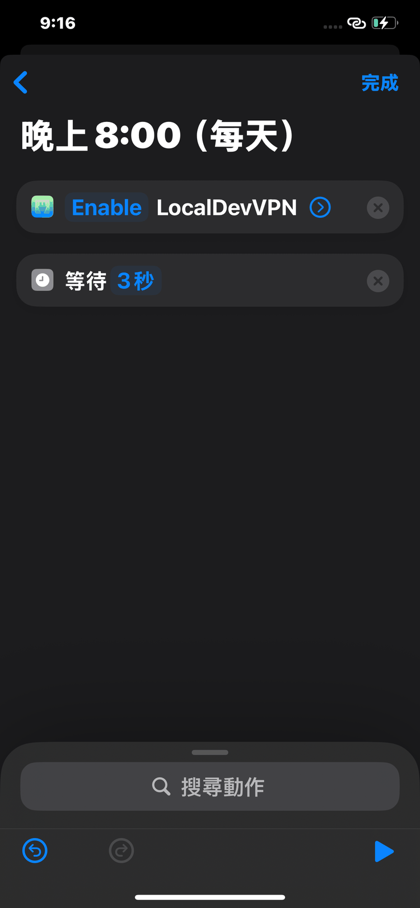

12. 再搜尋「PinFly」，點選「剩幾天內才續簽 PinFly」加入，天數保留 3。

    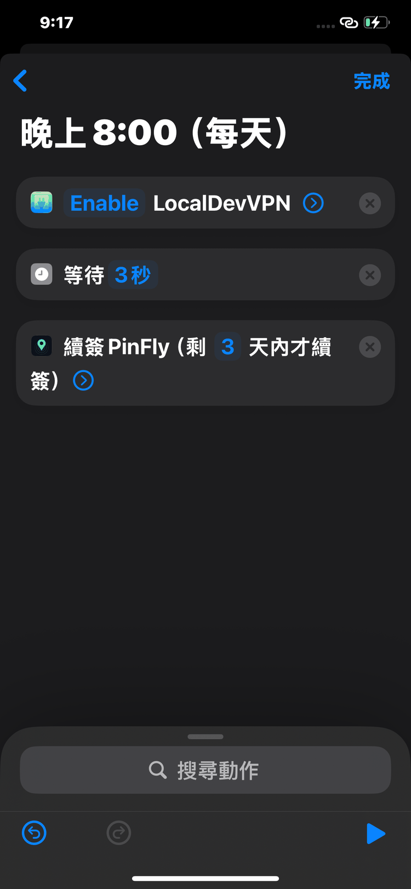

13. 確認三個動作依序為 LocalDevVPN、等待、續簽 PinFly。
14. 點右上角「完成」。

    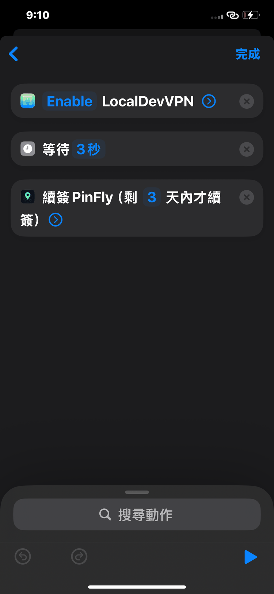

### 確認

15. 確認「自動化」顯示「立即執行」，點右上角「完成」。

    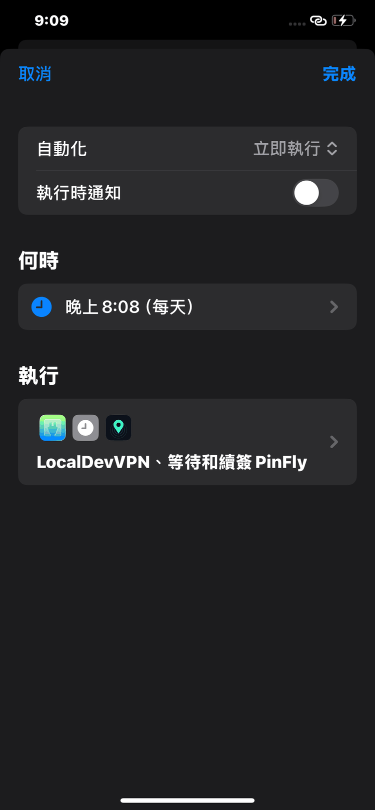

16. 確認「自動化」清單出現此項目。

    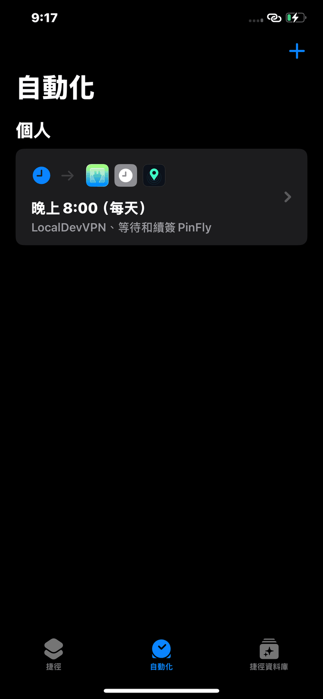

也可改選「鬧鐘」觸發，於關閉鬧鐘時執行。手機鎖定時，iOS 可能不讓動作跑完；失敗時打開 PinFly，按 `立即續簽`。

## 7.4 建議做法 B：只有 4G 時的兩段式續簽

只有 4G 時，安裝步驟需要關閉行動數據，所以要拆成兩段。下面是建議順序。 〔待確認：完整 4G 捷徑在公開版的實機測試結果〕

1. 加入 `下載 PinFly 描述檔`（4G 可以下載）。
2. 加入 `設定行動數據`，選「關」。 〔待確認：iOS 捷徑中的確切動作名稱〕
3. 加入 `LocalDevVPN：Enable`。
4. 加入 `等待`，設 3 秒。
5. 加入 `安裝 PinFly 描述檔`。
6. 加入 `設定行動數據`，選「開」。

## 7.5 一鍵換地點的捷徑

PinFly 首頁的 `捷徑` 按鈕，會尋找兩個名稱完全相同的捷徑：

- `出門改定位`：執行 4G 的連線與換地點步驟。
- `出門改定位續簽`：先續簽，再換地點。

要使用這個功能，請用這兩個名稱建立捷徑。 〔待確認：名稱是否會在公開版保留〕

> 捷徑名稱要和 App 內的名稱完全一樣（包括中文字），否則按鈕會找不到捷徑。

*截圖說明：PinFly 首頁「捷徑」按鈕展開後，顯示「執行出門改定位」等選項與「打開捷徑 App」按鈕。 〔待確認：為實際截圖〕*

## 7.6 查看與測試

1. 在「捷徑」App 中，點選你建立的捷徑，按 `播放`（三角形按鈕）手動執行一次。
2. 成功後，到 PinFly 的 `Apple 帳號與續簽` 頁面，看「續簽紀錄」是否多出一筆成功紀錄。
3. 也可以單獨執行 `查簽名剩幾天`，確認到期日是否改變。

## 7.7 注意事項

- 鎖屏時，iOS 可能不讓動作跑完整。若失敗，請解鎖手機，打開 PinFly，按 `立即續簽`。
- 自動化需要的權限（例如是否詢問「每次執行前詢問」）請依 iOS 的提示設定。 〔待確認：畫面文字〕
- 不要把自動化設成每分鐘執行，這樣會不斷嘗試登入 Apple，可能被暫時擋住。

*截圖說明：「捷徑」App 中自動化的執行紀錄，顯示最近一次執行的時間與結果。 〔待確認〕*
